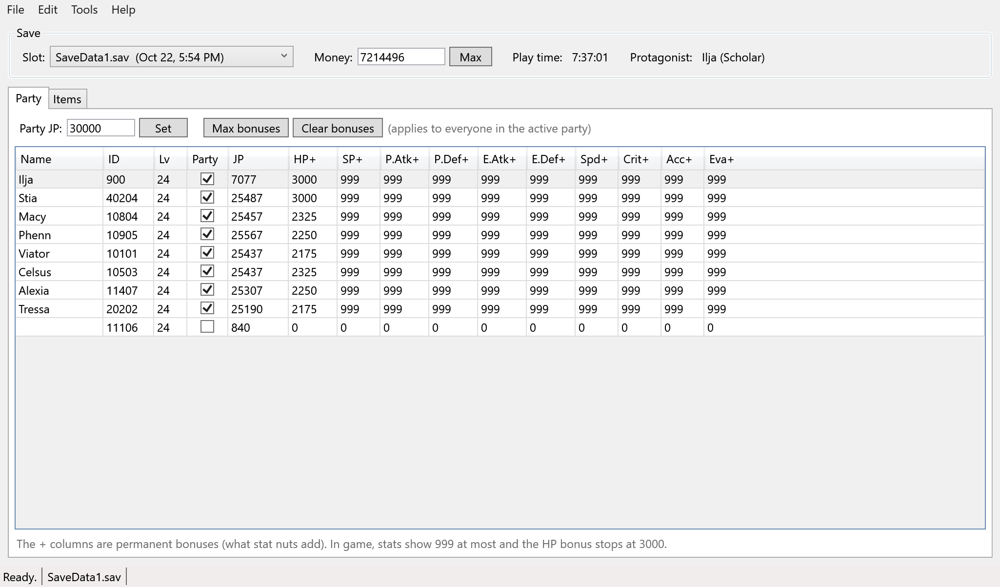
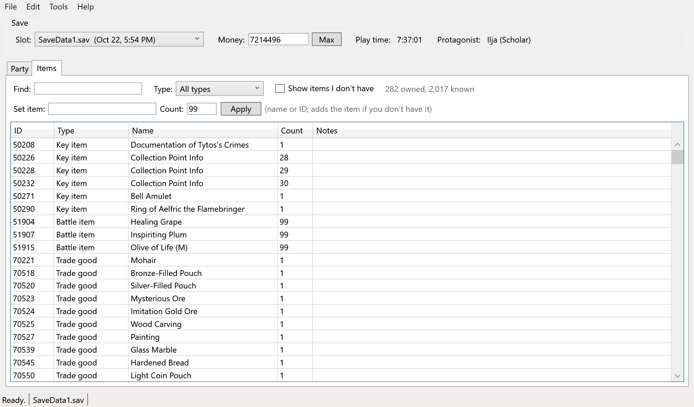
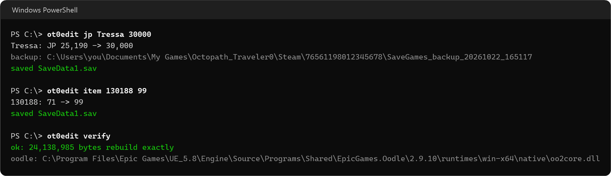

# ot0-save-editor

A save editor for Octopath Traveler 0 on Steam which edits money, JP, permanent stat bonuses and items, and can even add items you don't have yet. This program comes as a normal Windows app and a command-line tool.



## Before Using

Backups: The editor copies your entire SaveGames folder before every save (into `SaveGames_backup_`). It is still recommended to make your own backups in a separate folder.

CLOSE THE GAME: If OT0 is open it will overwrite your edit on the next autosave, so the editor refuses to save while it's running.

Steam Cloud: Might ask which copy to keep the next time you launch. When this occurs, always choose the local option.

## Requirements

Windows: The app is WPF, so Windows only.

.NET 10 SDK: Only needed to build it.

Oodle DLL (`oo2core*.dll`): The saves are compressed with Oodle, and the game has it baked straight into the exe. Although the license doesn't allow shipping a copy here, plenty of other software uses it, and the editor checks:

1. the folder the editor runs from
2. any Unreal Engine install under `Program Files\Epic Games` (they ship `oo2core.dll` for their .NET tools)
3. your Steam library

None of those? Pick one by hand under Tools > Oodle DLL in the app, or pass `--oodle <path>` / set `OT0_OODLE` for the command-line version. Please note that it has to be 64-bit.

## Building

```
dotnet build -c Release
```

The app: `src/Ot0Gui/bin/Release/net10.0-windows/OT0SaveEditor.exe`

The command-line tool: `src/Ot0Edit/bin/Release/net10.0/ot0edit.exe`

## The App

Opens your most recently played slot on launch. Switch slots from the dropdown.

Party tab: Every character in one grid (pictured earlier). JP and all ten bonuses can be typed straight into the cells. "Max bonuses" and "Clear bonuses" affect the whole active party at once, and so does "Set" for JP.

Items tab: Your inventory with every item's name and type, plus a find box and a type filter. Ticking "Show items I don't have" lists all 2,017 items the editor knows about, and typing a count into any of them adds it to your inventory. "Set item" takes a name or an ID. Key items, recipes and Wishvale items ask before being added, since getting one you haven't earned can interfere with story or Wishvale progress.



Menus: File for open/reload/save (Ctrl+O, F5, Ctrl+S), Edit for the party-wide changes, Tools for checking the save, exporting it as JSON, opening the backups folder and picking an Oodle DLL.

Unsaved changes: The title bar gets a `*`, and the status bar says "Modified". Closing or switching slots asks before any change is made.

## The Command-Line Version

The exact same features with no GUI. Works on whichever slot you played last unless you pass `--slot <n>` or `--file <path>`.

```
ot0edit info                        # play time, money, party, JP and bonuses
ot0edit money 9999999
ot0edit jp party 30000              # everyone in the active party
ot0edit jp Alexia 30000
ot0edit stat Viator hp 3000
ot0edit stat party all 999          # every bonus except HP
ot0edit items
ot0edit item "Nourishing Nut" 99    # names work as well as IDs
ot0edit item 130188 99
ot0edit find cornerstone            # search every known item, owned or not
ot0edit verify                      # parse and rebuild without writing anything
```

`<who>`: `party`, `all`, a name from `data/characters.json`, or a character ID.

Stat names: `hp sp patk pdef eatk edef spd crit acc eva`.

`--dry-run`: does every check but writes nothing.

`--force`: needed to add a key item, recipe or Wishvale item you don't have yet, or an ID the editor doesn't recognize.



## Item and Character IDs

The game's data files are encrypted, so names live in `data/items.json` and `data/characters.json`.

Items: The names come from the ID list patbz posted on the FearLess Cheat Engine forum in December 2025. Each item's type was then sorted by hand from its ID range, so a few of them could be off.

Characters: Still filled in by hand, which is why only part of the cast has a name so far.

Pull requests fixing a type or adding a character are welcome :)

## Misc

- Stat bonuses are what nuts add, kept separately from the level and gear part of each stat. The game won't show any stat past 999.
- Adding an ID the game doesn't have could break the save, which is why anything outside the item list needs `--force` (or a confirmation within the app).
- Not affiliated with Square Enix. MIT license, see [LICENSE](LICENSE).
